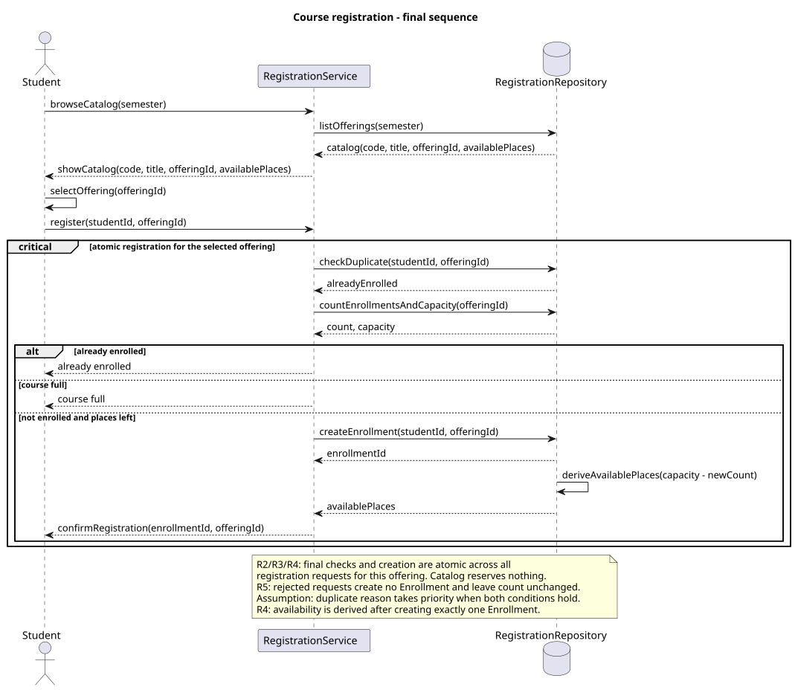
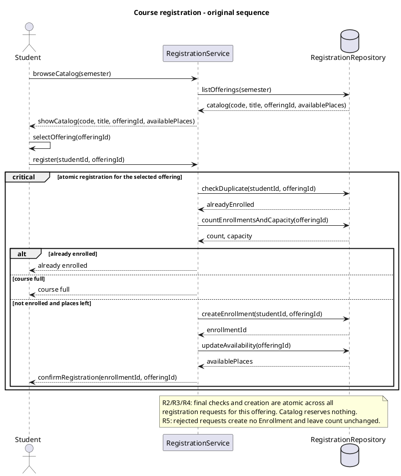
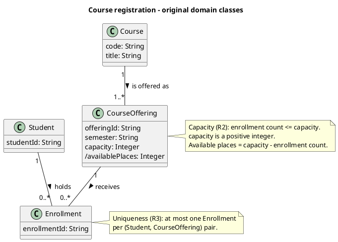
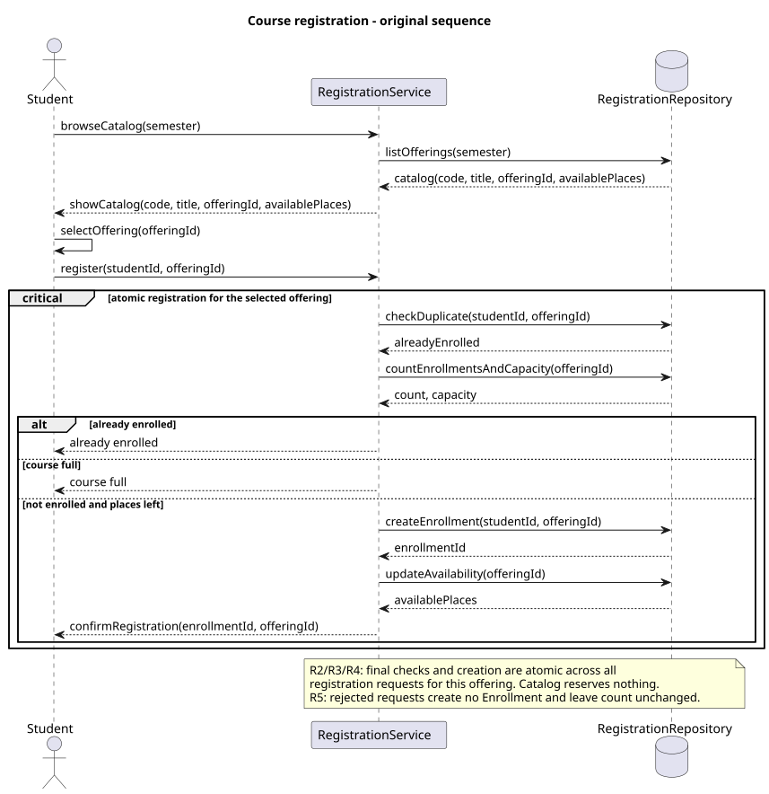
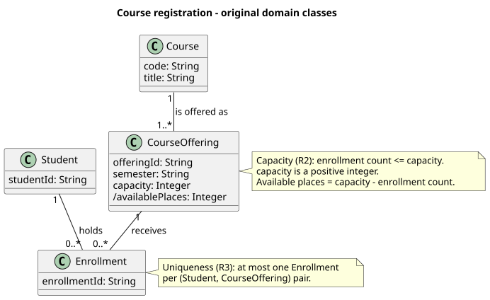

# SIS #02 — AI-Assisted UML Modeling: University Course Registration

## 1. Scope and assumptions

**Scope:** Model browsing a semester catalog and requesting registration for one CourseOffering, with capacity, uniqueness, success and rejection behavior. Payments, prerequisites, timetable clashes, waiting lists and cancellation are out of scope.

**Assumptions:**

1. The student is signed in, the offering exists, and capacity is a positive integer, as supplied.
2. Duplicate rejection takes priority if the student is enrolled and the offering is full; the rules do not specify priority.
3. A Course may have zero offerings; catalog browsing lists only scheduled offerings for the selected semester.
4. Available places are derived from capacity minus enrollment count. All final checks and creation are one atomic operation across competing registrations for that offering.

**Authorship:** This report, baseline, review decisions, walkthroughs and prose were prepared by Codex at the student's request. They are not independent student work. The requirements below are assistant-reviewed, not student-approved. The required new-chat critique was not performed.

## 2. User stories and acceptance criteria

### US-01 — Browse offerings

**US-01:** As a student, I want to browse offerings for one semester, so that I can select a suitable offering.

- **AC-01** (R1): Given offerings exist for a semester, When the student opens its catalog, Then each entry shows course code, title, offering identifier and available places.
- **AC-02** (R1, R2): Given the student views an offering with available places, When the student selects it, Then the offering is selected but no place is reserved and availability must be rechecked during registration.

### US-02 — Register for an offering

**US-02:** As a student, I want to register for a selected offering, so that I have a confirmed enrollment.

- **AC-03** (R2, R3, R4): Given the student is not enrolled and current count is below capacity, When registration atomically rechecks duplicate and capacity conditions, Then exactly one Enrollment links that student and offering, count increases by one, available places decrease by one, and confirmation follows creation.
- **AC-04** (R2, R4): Given capacity is two and current count is one for a new student, When registration atomically checks availability and creates the Enrollment, Then count becomes two, available places become zero, and confirmation is returned without exceeding capacity.

### US-03 — Receive a clear rejection

**US-03:** As a student, I want a clear registration rejection, so that I understand why registration did not succeed.

- **AC-05** (R2, R5): Given the catalog previously showed a place but the offering is now full and the student is not enrolled, When registration checks current capacity, Then it returns "course full", creates no Enrollment and leaves count unchanged.
- **AC-06** (R3, R5): Given the student already has an Enrollment in the selected offering, When the student requests registration again, Then it returns "already enrolled", creates no Enrollment and leaves count unchanged.

## 3. Sequence diagram



**Participants:** Student is the signed-in actor. RegistrationService coordinates catalog viewing and registration. RegistrationRepository represents current offering and enrollment state.

**Atomic operation:** The critical region includes checkDuplicate, countEnrollmentsAndCapacity and createEnrollment. It guarantees isolation across registration requests for the same offering: after one succeeds, a competitor must see its new count. A catalog view reserves nothing. Rejection branches make no writes. Availability is derived from the new count.

**Where the Enrollment is created:** RegistrationService sends createEnrollment(studentId, offeringId) to RegistrationRepository in the success branch. It produces one instance of the Enrollment class, linked to the selected Student and CourseOffering. confirmRegistration follows creation.

**Technical lifelines:** RegistrationService and RegistrationRepository are design responsibilities, not domain entities. The class diagram describes persistent business concepts; the sequence explains coordination. The repository label does not commit the system to a particular database technology.

## 4. Class diagram


| Association | Read left to right | Read right to left |
| --- | --- | --- |
| Student — Enrollment | One Student holds zero or more Enrollment records. | Each Enrollment belongs to exactly one Student. |
| CourseOffering — Enrollment | One CourseOffering receives zero or more Enrollment records. | Each Enrollment targets exactly one CourseOffering. |
| Course — CourseOffering | One Course has zero or more CourseOffering sections. | Each CourseOffering describes a section of exactly one Course. |

**How an Enrollment links a student to an offering:** Each Enrollment has an identifier and exactly one association endpoint to a Student and one to a CourseOffering. The associations express these references without redundant foreign-key attributes.

**Capacity constraint:** R2 limits enrollment count to the offering's positive integer capacity. Available places equal capacity minus count. Multiplicity 0..* alone has no knowledge of a particular offering's changing capacity value.

**Uniqueness constraint:** R3 allows at most one Enrollment per (Student, CourseOffering) pair. Neither association alone constrains that pair; separate uniqueness is therefore stated in a note.

## 5. Traceability

| Rule and criterion | Model evidence | Validation case |
| --- | --- | --- |
| R1 + AC-01, AC-02 | browseCatalog, listOfferings and showCatalog include code, title, offeringId and availablePlaces; CourseOffering.semester filters the catalog. | Extra catalog inspection: semester is requested and all four required fields return; selection creates nothing. |
| R2 + AC-02, AC-03, AC-04, AC-05 | countEnrollmentsAndCapacity after register; critical atomic region; CourseOffering capacity constraint. | T1, T2 and T3; competing final-place reasoning in section 8. |
| R3 + AC-03, AC-06 | checkDuplicate, already enrolled guard and Enrollment pair-uniqueness note. | T4: repeated registration creates nothing. |
| R4 + AC-03, AC-04 | createEnrollment then deriveAvailablePlaces then confirmRegistration; Enrollment endpoints. | T1 and T2: count increases exactly once. |
| R5 + AC-05, AC-06 | course full and already enrolled branches only return reasons; unchanged-count note. | T3 and T4: no new records, counts unchanged. |

## 6. Walkthroughs

These are Codex's actual symbolic traces of the final source, not student-performed walkthroughs or executable tests. In every case browseCatalog and listOfferings return a snapshot; selectOffering precedes register.

| Case | Observed path and state change | Judgment and evidence |
| --- | --- | --- |
| T1. Available | Capacity 2 and count 0: register enters critical; checkDuplicate returns false; countEnrollmentsAndCapacity returns 0,2; success calls createEnrollment once; count becomes 1, deriveAvailablePlaces gives 1, confirmRegistration returns its ID. | Pass — success guard, createEnrollment and confirmRegistration establish the path and final count. |
| T2. Last place | Capacity 2 and count 1: register enters critical; checkDuplicate returns false; countEnrollmentsAndCapacity returns 1,2; success creates one Enrollment; count becomes 2, availablePlaces becomes 0 and confirmation follows. | Pass — atomic region and success guard prevent creation beyond capacity. |
| T3. Full | Catalog snapshot showed one place; after selection, current count is 2 of 2. register checks duplicate false and reads count 2, capacity 2; course full branch replies without creation; count stays 2. | Pass — course full guard and reason reply show the stale catalog cannot authorize enrollment. |
| T4. Duplicate | Capacity 2 and count 1: register checks duplicate true and reads count 1, capacity 2; already enrolled branch replies; no createEnrollment occurs and count stays 1 despite a spare place. | Pass — already enrolled guard and its reply preserve the original enrollment count. |

## 7. Review decisions

These are assistant review decisions; the student did not independently judge the critique.

| AI suggestion or model element | Decision | Reason | Rule |
| --- | --- | --- | --- |
| Course 1..* CourseOffering minimum | Modified to 0..* in the final class source. | The scenario requires offerings to belong to courses but does not require every subject to be scheduled. | R1 |
| updateAvailability with derived /availablePlaces | Modified to deriveAvailablePlaces(capacity - newCount) after creation. | Deriving availability avoids suggesting an independent counter that could disagree with actual enrollments. | R2, R4 |
| Duplicate-first guard order | Accepted and documented as an assumption, retaining both rejection branches. | The rules allow either rejection reason when both hold, and no rejected request changes state. | R3, R5 |
| Atomic final checks and single creation | Accepted unchanged after T1-T4 and final-place competition tracing. | A competing registration must see the previous success before it can create another enrollment. | R2, R3, R4 |
| Student authorship and new-chat critique | Unresolved process deviation, disclosed rather than represented as completed. | Codex wrote the baseline and report, and cannot claim independent student work or a separate chat. | R1-R5 |

### Checker output

This is the actual structural checker output. Its PASS results do not establish independent authorship or compliance with the separate-chat process.

~~~~text
SIS #02 checker — report.md and models/
Checks SHAPE, never QUALITY.

  PASS   S1   all thirteen numbered sections present, in order
                sections 1-13 present, in order
  PASS   S2   no template markers left
                no template markers left
  PASS   W1   modeling explanation word count
                section 8 (Modeling explanation): 252 words, range 200-300
  PASS   W2   reflection word count
                section 9 (Reflection): 181 words, range 150-200
  PASS   A1   Appendix A: scope and initial assumptions written before AI
                scope statement and 2 initial assumptions
  PASS   Q1   user stories US-01 to US-03
                US-01, US-02 and US-03 written
  PASS   Q2   acceptance criteria AC-01 to AC-06 in Given / When / Then
                AC-01 to AC-06 each have Given, When and Then
  PASS   Q3   two criteria under each story
                two criteria under each story
  PASS   Q4   every criterion mapped to R1-R5, every rule covered
                every criterion names its rules; R1-R5 all covered
  PASS   Q5   nothing out of scope in the stories and criteria
                none of the five excluded features in the stories or criteria
  PASS   SQ1  every participant declared, every message named
                3 participants declared, 17 messages, all named
  PASS   SQ2  catalog browsing, then the registration request
                catalog "browseCatalog(semester)" then request "register(studentId, offeringId)"
  PASS   SQ3  guarded success, full-course and duplicate alternatives
                3 guarded alt branches: success, full and duplicate
  PASS   SQ4  duplicate and capacity checks between request and creation
                duplicate and capacity checked after the request, before creation
  PASS   SQ5  confirmation only after creation
                confirmation follows creation
  PASS   SQ6  rejection paths create, change and confirm nothing
                rejection branches create, update and confirm nothing (R5)
  PASS   SQ7  rejection paths return the reason
                each rejection branch returns its reason
  PASS   SQ8  the atomic operation is stated
                the atomic operation is stated
  PASS   CL1  Student, Course, CourseOffering and Enrollment
                Student, Course, CourseOffering and Enrollment present
  PASS   CL2  the attributes R1 and R2 need
                code, title, semester, capacity and a student identifier present
  PASS   CL3  multiplicities at both ends of every association
                3 associations, multiplicities at both ends
  PASS   CL4  each Enrollment links one Student and one CourseOffering
                1 Student and 1 CourseOffering per Enrollment, 0..* each way; 1 Course per CourseOffering
  PASS   CL5  capacity and uniqueness constraints stated
                capacity and uniqueness constraints stated in notes
  PASS   CL6  every extra class justified
                no extra classes
  PASS   CN1  lifelines are classes, or explained in section 3
                2 technical lifeline(s), each named in section 3
  PASS   CN2  every association read both ways in section 4
                3 association(s) read both ways in section 4, the diagram has 3
  PASS   F1   the AI's original diagrams kept
                both original AI diagrams kept in models/original/
  PASS   F2   four rendered images
                four renders in models/img/
  PASS   F3   image links in sections 3, 4 and 12 resolve
                every image link in sections 3, 4 and 12 resolves
  PASS   T1   traceability covers R1-R5
                R1-R5 each traced to a criterion, model evidence and a case
  PASS   T2   walkthroughs T1-T4 with path, verdict and location
                T1-T4: T1 pass, T2 pass, T3 pass, T4 pass
  PASS   T3   three review decisions with reasons
                5 complete review decision(s), 3 required
  PASS   T4   two source checks with exact locators
                2 source checks, every one with a locator
  PASS   R1   references
                2 reference(s); every table URL listed
  PASS   E1   four exchanges present
                exchanges found: B1, B2, B3, B4
  PASS   E2   exchange metadata
                metadata: tool, model, date and purpose on every exchange
  PASS   E3   prompts and responses complete
                every prompt and response pasted in full
  PASS   E4   Prompts A-D used as given
                Prompts A, B, C and D used as given
  PASS   E5   bracketed fields replaced in Prompts A and D
                every bracketed field replaced
  PASS   E6   Prompt A carries the rules and your assumptions
                rules R1-R5 pasted; 39 words shared with Appendix A
  PASS   E7   Prompt B carries the approved stories and criteria
                Prompt B carries US-01-03 and AC-01-06
  PASS   E8   the originals are Prompt B's output, unedited
                both originals are in the Prompt B response
  PASS   E9   Prompt C carries both diagrams
                Prompt C holds 2 PlantUML block(s)
  PASS   E10  Prompt D carries the original sources
                Prompt D contains 100% of the original sources (30%+ expected — "Original sources: [paste]")

Record these three numbers in submission.yml under checker:, with the commit hash
from `git rev-parse --short HEAD` — the commit this run was made at.
SUMMARY pass=44 fail=0 error=0
~~~~

## 8. Modeling explanation

This explanation was prepared by Codex rather than independently written by the student. The model separates Course, which describes a subject, from CourseOffering, which identifies a particular scheduled section and semester. Registration targets the offering because capacity belongs to that section. Enrollment connects exactly one Student and one CourseOffering. Three ordinary associations express these links without assuming inheritance or lifecycle ownership.

The class diagram describes structural possibilities, while its notes constrain valid states. A variable capacity cannot be expressed by the fixed multiplicity zero to many. Likewise, two individually valid association endpoints do not prevent duplicate student and offering pairs. The capacity and uniqueness notes supply these separate invariants. Available places are derived from enrollment count rather than stored as a second independent total.

The sequence diagram explains when those invariants are checked. Browsing returns a snapshot and selecting an offering changes no enrollment state. Registration checks duplicates and current capacity inside the same atomic region as creation. If two new students compete for the last place, the first successful creation changes the count before the other request can complete its final checks. The second must therefore follow the full branch. This is a modeling guarantee, not a tested database implementation.

Success creates one record, derives the remaining places and returns confirmation. Rejections return a reason without writes. An activity diagram could make these decisions easier to follow for readers interested in workflow rather than messages between participants. It would complement, rather than replace, the structural constraints and the sequence's atomicity statement.

## 9. Reflection

This section is an AI-authored process account, not the student's personal reflection. The student asked Codex to prepare the complete assignment and did not provide independent observations about modeling. It would therefore be inaccurate to claim that the student personally found a defect, traced the validation cases, opened the sources or learned a particular concept during this work.

Codex prepared the scope baseline, requirements, original diagrams, self-review, revised diagrams and the report. It also checked documentation and traced the four supplied cases against the final sequence. These activities provide reviewable artifacts, but they do not replace the independent work requested in the assignment. The critique happened in the existing workflow, so it also lacks the requested separation into a new chat.

The student's observable decision was to delegate preparation. No independent technical decision or ability to defend the models has been established. Remaining work for the student is to read the two diagrams, explain how atomic registration protects the last place, and write an authentic reflection. This account records that limitation rather than inventing personal experience to satisfy a word limit.

## 10. Appendix A — Before AI

**Scope:** Model a signed-in student's catalog browsing and registration for a specific course offering, including capacity, duplicate rejection and confirmation. Payments, prerequisites, timetable clashes, waiting lists and cancellation are excluded.

**Initial assumptions:**

1. The student is already signed in; the selected offering exists and has a positive integer capacity, as stated in the scenario.
2. Catalog availability is a snapshot, not a reservation; final checks and enrollment creation must be atomic.

**Provenance:** Codex wrote this baseline before the requirements draft, at the student's explicit request. It is not an independently student-written baseline and does not satisfy that authorship requirement. No claim otherwise is made.

## 11. Appendix B — AI exchanges

**Process disclosure:** These are four internally applied instruction-and-output stages of Codex in this existing workflow. The fixed prompt texts below were used as drafting instructions, not sent as four separate user messages. C is self-review, not a new chat. No student approval or independent judgment is claimed. The outputs are preserved as generated; external conversations are not fabricated.

### B1 — Requirements (Prompt A)

- **Tool:** Codex in ChatGPT Work
- **Model:** not displayed
- **Date:** 2026-10-18
- **Purpose:** Requirements (Prompt A); internal assisted stage, not an independent user chat

**Prompt:**

~~~~text
Act as a requirements analyst. Use only this course registration scenario and rules R1–R5: A student browses an electronic course catalog, chooses a course offering and requests
registration. Each offering has a limited number of places.
>
A Course describes a subject. A CourseOffering is one scheduled section in one semester.
Registration always targets a specific offering.
>
Assume that the student is signed in, the selected offering exists, and its capacity is a
positive whole number.
>
Exclude payments, prerequisites, timetable clashes, waiting lists and cancellation. Use
fictional students and courses.

| Rule | |
| --- | --- |
| **R1. Catalog** | Show the course code, title, offering and available places for one semester. |
| **R2. Capacity** | Recheck current availability when registering. Enrollment must never exceed the offering's capacity. |
| **R3. Duplicates** | A student may have at most one enrollment in the same offering. Reject a repeat request. |
| **R4. Success** | Create exactly one Enrollment linking the student and offering, update availability and return a confirmation. |
| **R5. Rejection** | Explain "course full" or "already enrolled". Create no enrollment and leave the enrollment count unchanged. |

These rules define this assignment. **A catalog view does not reserve a place.** Model the final
checks and enrollment creation as one atomic operation so competing requests cannot take the same
last place. A note describing the atomic operation is sufficient; database implementation is
outside this assignment.. My initial assumptions are 1. The student is already signed in; the selected offering exists and has a positive integer capacity, as stated in the scenario.
2. Catalog availability is a snapshot, not a reservation; final checks and enrollment creation must be atomic..
Draft 3 user stories and 2 Given / When / Then acceptance criteria for each. Use IDs US-01 to US-03 and AC-01 to AC-06. Map each criterion to rule IDs.
Cover normal and rejection behavior. List uncertainty separately. Do not add excluded features or invent university policies.
~~~~

**Response:**

~~~~text
### US-01 — Browse offerings

**US-01:** As a student, I want to browse offerings for one semester, so that I can select a suitable offering.

- **AC-01** (R1): Given offerings exist for a semester, When the student opens its catalog, Then each entry shows course code, title, offering identifier and available places.
- **AC-02** (R1, R2): Given the student views an offering with available places, When the student selects it, Then the offering is selected but no place is reserved and availability must be rechecked during registration.

### US-02 — Register for an offering

**US-02:** As a student, I want to register for a selected offering, so that I have a confirmed enrollment.

- **AC-03** (R2, R3, R4): Given the student is not enrolled and current count is below capacity, When registration atomically rechecks duplicate and capacity conditions, Then exactly one Enrollment links that student and offering, count increases by one, available places decrease by one, and confirmation follows creation.
- **AC-04** (R2, R4): Given capacity is two and current count is one for a new student, When registration atomically checks availability and creates the Enrollment, Then count becomes two, available places become zero, and confirmation is returned without exceeding capacity.

### US-03 — Receive a clear rejection

**US-03:** As a student, I want a clear registration rejection, so that I understand why registration did not succeed.

- **AC-05** (R2, R5): Given the catalog previously showed a place but the offering is now full and the student is not enrolled, When registration checks current capacity, Then it returns "course full", creates no Enrollment and leaves count unchanged.
- **AC-06** (R3, R5): Given the student already has an Enrollment in the selected offering, When the student requests registration again, Then it returns "already enrolled", creates no Enrollment and leaves count unchanged.

Uncertainty: If an offering is both full and already contains the student, the scenario does not specify reason priority. A duplicate-first check is a proposed choice, not an additional university policy. Technical implementation and failure recovery are unspecified. No excluded feature is added.

~~~~

### B2 — UML drafts (Prompt B)

- **Tool:** Codex in ChatGPT Work
- **Model:** not displayed
- **Date:** 2026-10-18
- **Purpose:** UML drafts (Prompt B); internal assisted stage, not an independent user chat

**Prompt:**

~~~~text
Using my approved scenario, R1–R5, stories and criteria below, return separate PlantUML code blocks for a sequence diagram and a domain class diagram.
Sequence: include catalog browsing and guarded success, full-course and duplicate outcomes. Model final checks and creation as one atomic operation.
Class: show domain concepts, useful attributes and multiplicities. State the capacity and uniqueness constraints. Explain assumptions and any technical lifelines.

Scenario and rules:
A student browses an electronic course catalog, chooses a course offering and requests
registration. Each offering has a limited number of places.
>
A Course describes a subject. A CourseOffering is one scheduled section in one semester.
Registration always targets a specific offering.
>
Assume that the student is signed in, the selected offering exists, and its capacity is a
positive whole number.
>
Exclude payments, prerequisites, timetable clashes, waiting lists and cancellation. Use
fictional students and courses.

| Rule | |
| --- | --- |
| **R1. Catalog** | Show the course code, title, offering and available places for one semester. |
| **R2. Capacity** | Recheck current availability when registering. Enrollment must never exceed the offering's capacity. |
| **R3. Duplicates** | A student may have at most one enrollment in the same offering. Reject a repeat request. |
| **R4. Success** | Create exactly one Enrollment linking the student and offering, update availability and return a confirmation. |
| **R5. Rejection** | Explain "course full" or "already enrolled". Create no enrollment and leave the enrollment count unchanged. |

These rules define this assignment. **A catalog view does not reserve a place.** Model the final
checks and enrollment creation as one atomic operation so competing requests cannot take the same
last place. A note describing the atomic operation is sufficient; database implementation is
outside this assignment.

Approved requirements (assistant-reviewed, not independently student-approved):
### US-01 — Browse offerings

**US-01:** As a student, I want to browse offerings for one semester, so that I can select a suitable offering.

- **AC-01** (R1): Given offerings exist for a semester, When the student opens its catalog, Then each entry shows course code, title, offering identifier and available places.
- **AC-02** (R1, R2): Given the student views an offering with available places, When the student selects it, Then the offering is selected but no place is reserved and availability must be rechecked during registration.

### US-02 — Register for an offering

**US-02:** As a student, I want to register for a selected offering, so that I have a confirmed enrollment.

- **AC-03** (R2, R3, R4): Given the student is not enrolled and current count is below capacity, When registration atomically rechecks duplicate and capacity conditions, Then exactly one Enrollment links that student and offering, count increases by one, available places decrease by one, and confirmation follows creation.
- **AC-04** (R2, R4): Given capacity is two and current count is one for a new student, When registration atomically checks availability and creates the Enrollment, Then count becomes two, available places become zero, and confirmation is returned without exceeding capacity.

### US-03 — Receive a clear rejection

**US-03:** As a student, I want a clear registration rejection, so that I understand why registration did not succeed.

- **AC-05** (R2, R5): Given the catalog previously showed a place but the offering is now full and the student is not enrolled, When registration checks current capacity, Then it returns "course full", creates no Enrollment and leaves count unchanged.
- **AC-06** (R3, R5): Given the student already has an Enrollment in the selected offering, When the student requests registration again, Then it returns "already enrolled", creates no Enrollment and leaves count unchanged.

~~~~

**Response:**

~~~~text
Sequence diagram:


Domain class diagram:


RegistrationService coordinates the use case; RegistrationRepository represents access to enrollment and offering state. They are technical lifelines, not additional domain classes. The Student lifeline represents the signed-in actor. The critical region states the required atomic behavior rather than selecting a database implementation. The count is obtained after the request and before creation. Rejections contain only reason replies and no writes. Success creates one Enrollment, updates availability, and confirms afterwards. Enrollment belongs to exactly one Student and one CourseOffering; CourseOffering belongs to one Course. A Course is assumed here to have at least one offering. Available places are derived from capacity minus enrollment count; updateAvailability represents making the resulting availability visible, not an independently maintained counter. Duplicate-first checking is a proposed precedence when both rejection conditions hold.

~~~~

### B3 — Model critique (Prompt C)

- **Tool:** Codex in ChatGPT Work
- **Model:** not displayed
- **Date:** 2026-10-18
- **Purpose:** Model critique (Prompt C); internal assisted stage, not an independent user chat

**Prompt:**

~~~~text
Review these two UML models against R1–R5 and my acceptance criteria. Check message order, guards, state changes, multiplicities and naming.
Inspect the four validation cases: available places, exactly one place, full course after a stale catalog view, and duplicate registration.
For each issue, cite the affected rule and model element. Explain the impact and propose a focused correction. Separate genuine defects from optional design choices.

Scenario and R1-R5:
A student browses an electronic course catalog, chooses a course offering and requests
registration. Each offering has a limited number of places.
>
A Course describes a subject. A CourseOffering is one scheduled section in one semester.
Registration always targets a specific offering.
>
Assume that the student is signed in, the selected offering exists, and its capacity is a
positive whole number.
>
Exclude payments, prerequisites, timetable clashes, waiting lists and cancellation. Use
fictional students and courses.

| Rule | |
| --- | --- |
| **R1. Catalog** | Show the course code, title, offering and available places for one semester. |
| **R2. Capacity** | Recheck current availability when registering. Enrollment must never exceed the offering's capacity. |
| **R3. Duplicates** | A student may have at most one enrollment in the same offering. Reject a repeat request. |
| **R4. Success** | Create exactly one Enrollment linking the student and offering, update availability and return a confirmation. |
| **R5. Rejection** | Explain "course full" or "already enrolled". Create no enrollment and leave the enrollment count unchanged. |

These rules define this assignment. **A catalog view does not reserve a place.** Model the final
checks and enrollment creation as one atomic operation so competing requests cannot take the same
last place. A note describing the atomic operation is sufficient; database implementation is
outside this assignment.


Acceptance criteria:
### US-01 — Browse offerings

**US-01:** As a student, I want to browse offerings for one semester, so that I can select a suitable offering.

- **AC-01** (R1): Given offerings exist for a semester, When the student opens its catalog, Then each entry shows course code, title, offering identifier and available places.
- **AC-02** (R1, R2): Given the student views an offering with available places, When the student selects it, Then the offering is selected but no place is reserved and availability must be rechecked during registration.

### US-02 — Register for an offering

**US-02:** As a student, I want to register for a selected offering, so that I have a confirmed enrollment.

- **AC-03** (R2, R3, R4): Given the student is not enrolled and current count is below capacity, When registration atomically rechecks duplicate and capacity conditions, Then exactly one Enrollment links that student and offering, count increases by one, available places decrease by one, and confirmation follows creation.
- **AC-04** (R2, R4): Given capacity is two and current count is one for a new student, When registration atomically checks availability and creates the Enrollment, Then count becomes two, available places become zero, and confirmation is returned without exceeding capacity.

### US-03 — Receive a clear rejection

**US-03:** As a student, I want a clear registration rejection, so that I understand why registration did not succeed.

- **AC-05** (R2, R5): Given the catalog previously showed a place but the offering is now full and the student is not enrolled, When registration checks current capacity, Then it returns "course full", creates no Enrollment and leaves count unchanged.
- **AC-06** (R3, R5): Given the student already has an Enrollment in the selected offering, When the student requests registration again, Then it returns "already enrolled", creates no Enrollment and leaves count unchanged.

~~~~

**Response:**

~~~~text
This is a same-workflow self-review by Codex, not the required new-chat critique. No independent student judgment is claimed.

1. Optional restriction, Course association: Course "1" -- "1..*" CourseOffering assumes every Course has an offering. R1 distinguishes the subject from scheduled offerings, but imposes no minimum offering count. This is not a demonstrated R1 failure for the supplied catalog. Prefer 0..* unless that minimum is explicitly justified; a subject could exist without being scheduled in the selected semester.
2. Clarification, updateAvailability(offeringId): R4 requires updated availability. The class declares /availablePlaces as derived, but the message could suggest a separately stored counter. No definite defect follows because the draft explanation says it makes the derived result visible. Prefer replacing it with a deriveAvailablePlaces message and reply that explicitly uses the new enrollment count. This avoids an unnecessary second source of truth.
3. Optional choice, duplicate-first guards: the model evaluates already enrolled before course full. R3/R5 do not choose a priority when both hold. Retain this choice and document that it is an assumption; it changes neither rejection's count nor creates a record.
4. Verified element, critical atomic registration: checkDuplicate and countEnrollmentsAndCapacity occur after register and before createEnrollment. R2/R3 are covered only if the atomic guarantee applies across competing requests for that offering, which the note states. Keep the critical region and note; no database mechanism is required.
5. Verified element, success/rejection branches: R4 creation precedes confirmation and happens once. R5 branches contain only already enrolled or course full replies. T1 follows count 0 to 1; T2 follows 1 to 2; T3 uses current count 2 despite a stale catalog; T4 sees an existing enrollment and remains at 1. These are symbolic checks of the diagram, not executable application tests. Keep the branches.

No definite violation of R1-R5 is established in the original models under their documented assumptions. The first two proposed edits improve scope discipline and clarity, rather than repairing an invented defect. Student review and independent explanation remain outstanding.

~~~~

### B4 — Focused revision (Prompt D)

- **Tool:** Codex in ChatGPT Work
- **Model:** not displayed
- **Date:** 2026-10-18
- **Purpose:** Focused revision (Prompt D); internal assisted stage, not an independent user chat

**Prompt:**

~~~~text
Revise the UML sources using only my accepted review decisions: Change Course-to-CourseOffering minimum to zero; express available places as derived after creation; retain and document duplicate-first rejection; keep the atomic region and unchanged rejection paths. These are Codex review decisions, not independently student-authored decisions.. Keep justified existing elements and explain each change.
Preserve the agreed scope and rule IDs. Return both updated PlantUML blocks and a concise change log. Flag any unresolved issue.
Approved requirements: ### US-01 — Browse offerings

**US-01:** As a student, I want to browse offerings for one semester, so that I can select a suitable offering.

- **AC-01** (R1): Given offerings exist for a semester, When the student opens its catalog, Then each entry shows course code, title, offering identifier and available places.
- **AC-02** (R1, R2): Given the student views an offering with available places, When the student selects it, Then the offering is selected but no place is reserved and availability must be rechecked during registration.

### US-02 — Register for an offering

**US-02:** As a student, I want to register for a selected offering, so that I have a confirmed enrollment.

- **AC-03** (R2, R3, R4): Given the student is not enrolled and current count is below capacity, When registration atomically rechecks duplicate and capacity conditions, Then exactly one Enrollment links that student and offering, count increases by one, available places decrease by one, and confirmation follows creation.
- **AC-04** (R2, R4): Given capacity is two and current count is one for a new student, When registration atomically checks availability and creates the Enrollment, Then count becomes two, available places become zero, and confirmation is returned without exceeding capacity.

### US-03 — Receive a clear rejection

**US-03:** As a student, I want a clear registration rejection, so that I understand why registration did not succeed.

- **AC-05** (R2, R5): Given the catalog previously showed a place but the offering is now full and the student is not enrolled, When registration checks current capacity, Then it returns "course full", creates no Enrollment and leaves count unchanged.
- **AC-06** (R3, R5): Given the student already has an Enrollment in the selected offering, When the student requests registration again, Then it returns "already enrolled", creates no Enrollment and leaves count unchanged.
. Original sources: ```plantuml
@startuml
title Course registration - original sequence
actor Student
participant RegistrationService
database RegistrationRepository
Student -> RegistrationService : browseCatalog(semester)
RegistrationService -> RegistrationRepository : listOfferings(semester)
RegistrationRepository --> RegistrationService : catalog(code, title, offeringId, availablePlaces)
RegistrationService --> Student : showCatalog(code, title, offeringId, availablePlaces)
Student -> Student : selectOffering(offeringId)
Student -> RegistrationService : register(studentId, offeringId)
critical atomic registration for the selected offering
RegistrationService -> RegistrationRepository : checkDuplicate(studentId, offeringId)
RegistrationRepository --> RegistrationService : alreadyEnrolled
RegistrationService -> RegistrationRepository : countEnrollmentsAndCapacity(offeringId)
RegistrationRepository --> RegistrationService : count, capacity
alt already enrolled
RegistrationService --> Student : already enrolled
else course full
RegistrationService --> Student : course full
else not enrolled and places left
RegistrationService -> RegistrationRepository : createEnrollment(studentId, offeringId)
RegistrationRepository --> RegistrationService : enrollmentId
RegistrationService -> RegistrationRepository : updateAvailability(offeringId)
RegistrationRepository --> RegistrationService : availablePlaces
RegistrationService --> Student : confirmRegistration(enrollmentId, offeringId)
end
end
note over RegistrationService, RegistrationRepository
R2/R3/R4: final checks and creation are atomic across all
registration requests for this offering. Catalog reserves nothing.
R5: rejected requests create no Enrollment and leave count unchanged.
end note
@enduml
```


Updated domain class diagram:


Change log: Course now has zero or more offerings, removing an unrequired minimum. Availability is calculated from the new enrollment count after creation instead of implying a stored second counter. A note makes duplicate-first priority explicit. The atomic checks, single creation, confirmation order, required class names and state-preserving rejection branches are retained. No extra feature or university policy is introduced. Unresolved process issues: the student has not independently reviewed these decisions; this critique ran in the existing workflow rather than a new chat. The diagrams specify atomicity but do not implement or test a database transaction, which is outside scope.

~~~~

## 12. Appendix C — Original diagrams





The originals are the exact initial Codex diagram sources in B2, preserved before revision. Their rendering does not modify the source.

## 13. Appendix D — References and source checks

### References

- PlantUML. Sequence Diagram syntax and features, "Grouping message" section. https://plantuml.com/sequence-diagram — accessed 2026-10-18 by Codex.
- PlantUML. Class Diagram syntax and features, "Label on relations" section. https://plantuml.com/class-diagram — accessed 2026-10-18 by Codex.

### Source checks

These pages were opened and read by Codex through browsing. The student has not claimed to open or read them personally. They support notation, not proof that a software implementation is race-free.

| Modeling decision | Source and locator | What the source says | How it supports or changed your model |
| --- | --- | --- | --- |
| Use guarded alternatives and a critical region. | PlantUML Sequence Diagram, section "Grouping message", https://plantuml.com/sequence-diagram accessed 2026-10-18. | The documented grouping syntax includes alt/else and critical, with end closing a group. | Retained separate guarded outcomes and a critical registration region; the scenario supplies the atomicity requirement. |
| Show association multiplicities explicitly. | PlantUML Class Diagram, section "Label on relations", https://plantuml.com/class-diagram accessed 2026-10-18. | Cardinalities are written in quotes at the relation ends. | Verified the syntax for Student/Enrollment, CourseOffering/Enrollment and Course/CourseOffering; domain meaning follows the scenario. |

